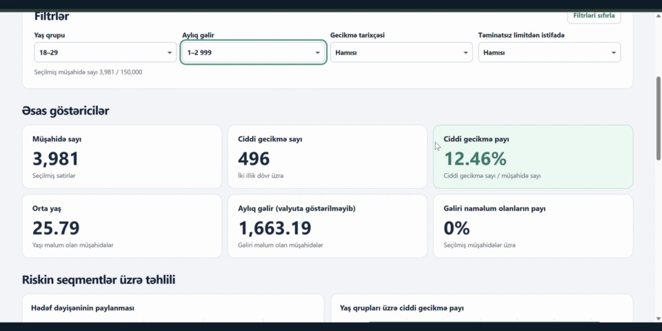

# Kredit Risklərinin Təhlili



150 000 müşahidə üzrə interaktiv kredit riski paneli. Yaş, aylıq gəlir, gecikmə tarixçəsi və təminatsız kredit limitindən istifadə üzrə filtrlər təqdim edir.

[Canlı idarə paneli](https://rashidjafarov.com/projects/credit-risk/)

## İşə salmaq

`dashboard/index.html` faylını brauzerdə açın. Plotly.js və panelin istifadə etdiyi qruplaşdırılmış göstəricilər repoya daxildir.

İlkin təhlil `analysis.ipynb` dəftərindədir. Göstəriciləri yenidən hesablamaq üçün [Give Me Some Credit](https://www.kaggle.com/competitions/GiveMeSomeCredit/data) təlim faylını `data/cs-training.csv` ünvanında saxlayın və işlədin:

```sh
python -m pip install pandas numpy plotly
python prepare_data.py
```

